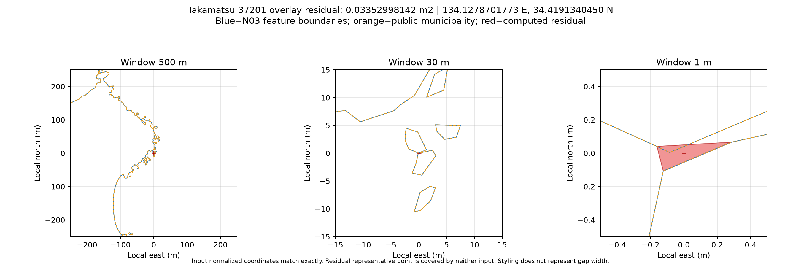

# 提供N03と公開市町村版の形状比較（2026-10-13）

原典と公開物を読み取り専用で比較しました。系番号の判定処理、公開データ、既存Releaseは変更していません。大きな原典・差分GeoPackageはGitに含めていません。

## 入力と方法

利用者提供の `shp.zip`（N03-20260101.shp等）、`N03-20260101_prefecture.zip`、公開Release v2026.1の市町村版を使用しました。ZIPの版・実測SHA-256・サイズは[input-manifest.json](input-manifest.json)に記録しました。提供ZIPと過去の全国GML ZIPは別アーカイブで、ファイル名だけで同一性を推定していません。

座標系はEPSG:6668（JGD2011経緯度）です。座標の許容幅は0、面積による合否閾値は設けていません。スナップ、丸め、簡略化、バッファ、穴埋め、形状修復は行っていません。面積はGRS80楕円体の測地面積です。

N03_007別に原典を集約し、公開市町村版も同じコード別に再結合しました。複数系の5自治体を含めています。正規化座標の一致と、差分演算の空・非空を別に記録し、今回の全国再検証では座標が一致していても双方向差分を計算しました。

## 市町村コード別の結果

| 項目 | 実測結果 |
|---|---:|
| 原典地物 | 125,130 |
| 公開市町村地物 | 1,911 |
| 双方の市町村コード | 1,905 |
| 正規化座標の完全一致 | 1,905 / 1,905 |
| 双方向差分が空 | 1,904 / 1,905 |
| 非空差分 | 高松市37201のみ |
| 原典集約のみの差分面積 | 0.0335299814178㎡ |
| 公開版のみの差分面積 | 0㎡ |
| 集約後の内部リング | 双方189個 |
| 無効な入力形状・計算例外 | 0 |

全コードの結果は[municipality-comparison.csv](municipality-comparison.csv)です。

高松市の三角形状の演算残差は、既存検証記録を再現しました。しかし、その代表点は集約前のN03地物にも公開地物にも含まれませんでした。正規化座標も一致しているため、この残差だけで公開版の実際の地物欠落とは断定しません。[代表点の記録](takamatsu-point-evidence.json)を参照してください。



赤は計算された残差、青・橙は入力の境界です。線の太さや中心マーカーは隙間の実際の幅を表しません。利用者報告の画像位置との同定は未実施です。

## 都道府県版との別比較

市町村版原典を都道府県単位に集約し、提供都道府県版123,025地物も47コード別に集約しました。都道府県版を自治体コード比較の原典に代用していません。

全47県を完了しました。双方向差分が空なのは島根県32000の1県、非空は46県です。県別差分の面積合計は、市町村集約側のみ422.329253792㎡、都道府県版側のみ289.630900060㎡でした。これは県別の合計で、全国の合併領域の差分面積とは別です。

[prefecture-comparison.csv](prefecture-comparison.csv)に全47件を保存しました。差分から選んだ代表点247件では、該当県に属する集約前の入力地物の包含が原典2種類で異なることを確認しました。[点の記録](prefecture-point-evidence.json)を参照してください。選んだ点の証拠であり、全差分の原因・法令上の境界・利用者画像の原因を確定するものではありません。

差分GeoPackageは85地物、EPSG:6668、無効0・空0、SQLite整合性okでした。最初に完了していた8県の表は再生成結果と全項目一致しました。空の差分から代表点座標を求める補助処理の不具合は、空の正常ケースの検査と修正後、保存済み結果を再利用して完了しています。

機械可読の結果と処理系の版は[measured-summary.json](measured-summary.json)にあります。原典DBFを指定した既存テストも実行しました。ArcGIS Proでの互換性、指摘画像の具体的位置・表示条件、系番号の法令上の意味的確認は、この形状比較の検証範囲に含めていません。

## 再実行

Python 3.12と任意の検証用依存関係を使用します。通常の開発テストにこれらの追加依存関係は必須ではありません。

```bash
python3.12 -m venv .venv
.venv/bin/python -m pip install -r scripts/geometry_audit/requirements.txt
.venv/bin/python scripts/audit_n03_geometry.py \
  --source-shp INPUT/N03-20260101.shp \
  --municipalities INPUT/plane_rectangular_municipalities_2026.gpkg \
  --output output/n03-audit
.venv/bin/python scripts/audit_prefecture_geometry.py \
  --source-shp INPUT/N03-20260101.shp \
  --prefecture-shp INPUT/N03-20260101_prefecture.shp \
  --prior-comparison docs/geometry-audit-20261013/prefecture-comparison.json \
  --output output/prefecture-audit --workers 4
```

`INPUT`を実ファイルの場所に置き換え、原典SHP・SHX・DBF・PRJ・CPGを揃えてください。市町村GPKGは[Release v2026.1](https://github.com/yo-1/japan-plane-rectangular-cs-zones/releases/tag/v2026.1)の市町村ZIPから展開します。入力ZIPのハッシュを先に照合してください。

市町村比較の出力先は未作成である必要があります。`--codes 37201`では高松市だけを再計算でき、全件検証とは区別します。都道府県比較は入力ハッシュ・処理系・県別キャッシュを検証して再開できます。同じ条件の完了出力はハッシュ照合後に再利用します。入力が変わった場合は別の出力先を使用してください。

都道府県比較は4 CPU相当・32 GBメモリの環境で4プロセスを使用しました。詳細な差分は大きく、GeoJSON約812 MiB・GeoPackage約377 MiBに加え県別キャッシュが必要でした。全47件と終了コード0を確認し、非空差分を自動的に検査失敗や地物欠落と解釈しないでください。原典は変更せず、生成物はignoredのoutput等へ保存します。

出典は国土交通省「国土数値情報（行政区域データ）2026年版」です。データの出典・利用条件は[DATA_LICENSE.md](../../DATA_LICENSE.md)を保持します。
