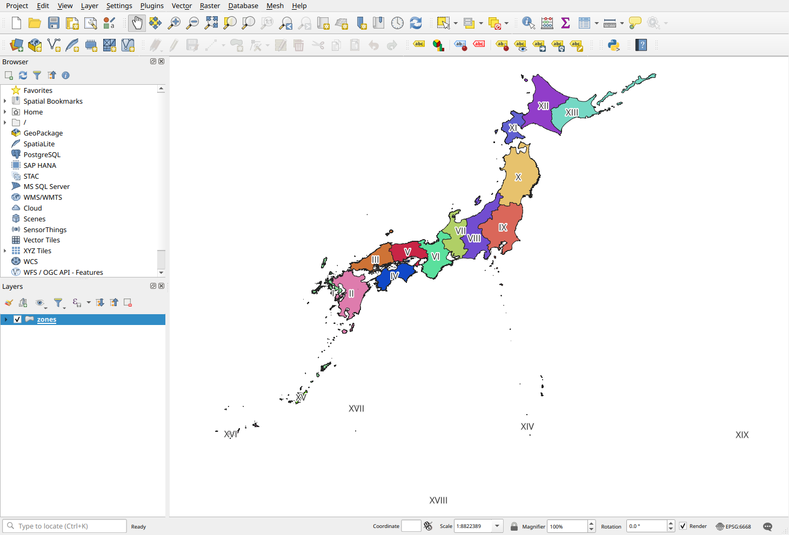
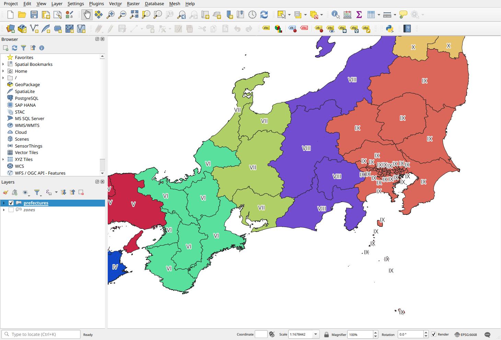
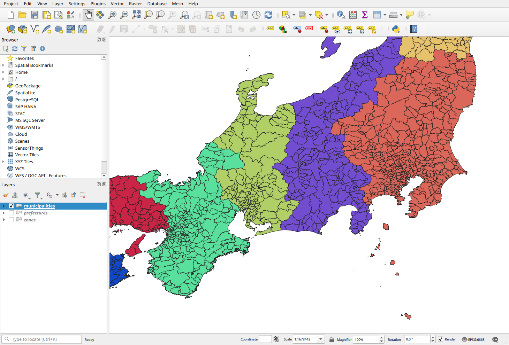
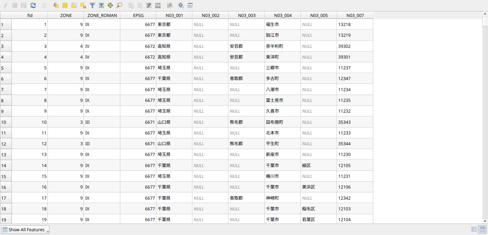

# v2026.3のQGIS表示・Processingとprobeの実行検証（2026-11-19）

正式Release v2026.3の3種類を、QGIS 3.44.13とqgis-dev-probe v0.1.4で実際に読み込みました。色分け・属性・保存済みラベル設定を確認し、系19件のGEOS検査と、合成データのバッファ処理をMCP経由で実行しました。配布データの補修・上書きは行っていません。

**総合判定は一部失敗です。** probeにはアクション列挙の欠落が見つかりました。表示・Processingの成功と、probeの全機能の合格は区別します。ArcGISの既存記録も照合しましたが、今回照合した公開記録にはv2026.3本体の実機結果を確認できませんでした。

## 入力と実行環境

- 正式版：[v2026.3](https://github.com/yo-1/japan-plane-rectangular-cs-zones/releases/tag/v2026.3)。ZIP3本のSHA-256とCRCを確認し、各ZIPのGeoPackageを別の検証用ディレクトリへ展開しました。[入力一覧](input-manifest.json)にZIP・GPKGのSHA-256、レイヤ名、属性、スタイル情報を記録しています。
- QGIS：3.44.13-Solothurn / Qt 5.15.13 / PyQt 5.15.10 / Python 3.12.3 / Linux。公式イメージ `qgis/qgis:3.44.13-noble`、digest `sha256:4389d5ed64d7fc89647ac5cea45f97274a7e85b35d8bb7869810be297667ed79`。
- probe：mainのコミット `a4f54e96877bf2782b52ec302bca5ba18c1cbb9b`、v0.1.4。公開Release latestのv0.1.3とは区別します。上流ソースは変更していません。最低対象版3.44を満たしています。
- MCP：SDK 2.3.0。実際のstdio Client → probeのloopback TCP → 実QGIS GUIという経路です。偽のiface・偽の応答ではありません。Xvfbで画面を描画し、MCPの画像応答を保存・表示確認しました。
- GUI起動時にニュースフィードのTLS確認画面が出たため、ローカルデータ検査は外部通信なしのコンテナで実施しました。TLS例外の保存・検証無効化はしていません。日本語表示にはホストのフォントを読み取り専用で渡しました。

GeoPackageは読み取り専用でマウントしました。実行後も入力3ファイルのSHA-256が一致しています。[結果集計](summary.json)、[起動記録](startup.json)、[終了確認](lifecycle.json)を保存しました。終了コード0でQGISを閉じ、Xvfbとprobeを停止し、endpointを削除しています。

## 表示と属性

全レイヤでEPSG:6668、フィーチャ件数、元ファイルの全属性列名が一致しました。`EPSG`属性は所属する平面直角座標系のコードで、格納座標のEPSG:6668とは別です。系番号・コード・日本語属性の表示をサンプル確認しました。属性の地理的・法的な正しさを新たに認定したという意味ではありません。

|対象|件数|分類表示|保存済みラベル|全国表示の配置ラベル数|拡大表示の配置ラベル数|
|---|---:|---|---|---:|---:|
|系|19|ZONE_ROMAN、20分類（その他を含む）|ON、ZONE_ROMAN|19（I〜XIX）|7|
|都道府県単位×系|392|同上|ON、ZONE_ROMAN|113|53|
|市区町村×系|1,911|同上|OFF|0|0|

市町村版は元のQMLの `labelsEnabled=0` と読み込み結果が一致します。メモリ上だけで一時的にONにした拡大画面では448ラベルを確認し、その後OFFへ戻しました。ラベルが過密なので、読みやすさの合格とは区別します。配布スタイルを変更したものではありません。全縮尺・全端末のフォント一致を保証しません。

系レイヤは `ZONE`・`ZONE_ROMAN`・`EPSG`、都道府県単位はさらに `UNIT_CODE`・`UNIT_NAME`等、市町村版は `N03_*`属性を持ちます。一律に全レイヤへ `UNIT_*`列を要求せず、実ファイルのスキーマと照合しました。

手元にあったv2026.2の系・市町村版については、QMLとSLDがv2026.3と完全一致しました。[スタイル比較](style-comparison.json)を参照してください。都道府県単位の旧版とのファイル比較は今回実施していません。

その他の[取得画像](figures/)には、各レイヤの全国・拡大・属性画面と、市町村の一時ラベルON画面を保存しています。

## MCP経由の操作とProcessing

- レイヤ追加、属性・件数の取得、属性テーブルの撮影と終了、合成入力・生成レイヤの削除を確認しました。画面の切替・詳細計測には検査用のローカルレシピを使いました。
- `native:buffer`：EPSG:3857の合成点1件を10m、8セグメント/四半円で処理。出力は1ポリゴン、面積312.1445152258052㎡で、円の近似として期待範囲でした。行政区域にバッファをかけたものではありません。
- `qgis:checkvalidity`：正式系レイヤ19件をMETHOD=2（列挙定義でGEOSと確認）で処理。有効19、無効0、エラー0です。無効図形を自動修復していません。この結果はEsri方式検査ではありません。
- 表示・Processingの実行回は87回のMCP呼び出しを保存しています。[MCP実応答](mcp-results.json)にパラメータ・結果・ログ・画像名があります。都道府県・市町村のGEOS全件検査は公開済み結果と重複するため、このProcessing試験では繰り返していません。

最新版では `run_recipe` も任意コード実行の区分です。先行する同版の未許可セッションで `execute_code` と `run_recipe` が拒否されることを確認しました。[拒否の記録](permission-denial-evidence.json)を保存しています。成功回は専用セッションで実行許可を有効にし、作成した既知のレシピだけを実行しました。許可がレシピごとの実行制限を強制する仕組みだとは扱いません。永続的な実行許可や常駐サーバーは残していません。

上流の既存170テストと、本リポジトリのN03_DBF指定100テストも成功（いずれもスキップ0・失敗0）しました。入力準備スクリプトの再実行一致と、既存結果の上書き拒否も確認しました。これらには模擬Qt等の単体テストが含まれ、実GUIの全機能合格という意味ではありません。

[判定の集計](audit-outcomes.json)は、表示・Processingが合格、アクション列挙が不合格、総合が一部失敗です。実応答JSONの初期ランナーによる `success=true` は表示・Processing完了だけを意味します。記録済み応答を再集計し、再実行ランナーはこの欠落を検出した場合に非ゼロ終了するようにしました。実GUIの試験を飛ばして合格にしたものではありません。

## probeで見つかったアクション列挙の欠落

未変更v0.1.4の同じQGISで、次を記録しました。

|観察|Zoom系アクション数|
|---|---:|
|probeのlist_actions、参照保持前|0|
|QtのfindChildren(QAction)|10|
|Qt側の参照を保持した状態で同じprobe呼び出し|9|

Qtには `mActionZoomFullExtent` 等が実在しますが、通常のprobe列挙・検索では見つからない呼び出しがありました。[全診断結果](action-enumeration.json)を保存しています。Qt側の全アクション数は676でした。9と10の差にはウィジェットに属さないアクション等もあり得るため、Qtの全子オブジェクトがprobe列挙へ必ず出るという要件にはしていません。一方、保持前0→保持中9という差は再現しています。

Pythonラッパーの寿命と、列挙処理が `id()` の値だけで重複排除していることが関係する可能性があります。これは原因候補で、上流の修正・修正後の回帰試験は今回実施していません。`trigger_action` 全般、`set_widget`、`click_widget`の合格を宣言しません。レイヤ追加・削除やProcessingの成功と混同しません。

## ArcGIS記録との照合

[照合一覧](arcgis-evidence.json)に、版・SHA・対象・検査方式・参照先をまとめました。

|対象|再利用できる既存証拠|今回の判断|
|---|---|---|
|v2026.2の正式19系|森林同梱版との全19行一致に基づく基本認識・描画|旧版の該当範囲で再利用します|
|20261015調査用13候補|直接GPKGは問題0、変換後GDBのEsri方式は自己交差4|正式19系自体の不具合件数と扱いません|
|森林025や全国森林GDB|森林PR #6等の実機・座標照合|別の集約単位・入力であり、再実行を依頼しません|
|正式v2026.3の3種類|公開PR #33、VALIDATION、Issue #15等を照合|今回照合した公開記録では、3ZIPのSHAと結び付くArcGIS実機結果を確認できませんでした|

森林側の最新READMEは確認用v0.8を案内し、共有19系はv2026.2と記載しています。正規化したN03が共通でも、森林の検査をv2026.3正式版の合格へ流用しません。別チャットや非公開の未反映記録が存在しないとは断定しません。

このLinux環境にarcpyはなく、ArcGIS Proを実行したとは報告しません。Issue #15や過去のハッシュ照合Issueは閉じません。v2026.3のArcGIS互換性は未確認のままです。今回のQGIS結果でEsri内部原因や岩礁の所属を確定していません。

## 再実行

[実行手順](../../scripts/probe_runtime_audit/README.md)を参照してください。既存出力を上書きしない、新しい試験ディレクトリを使います。元データ・既存Release・上流probeコードは変更しません。再実行スクリプトはこの対象版・固定入力の監査用で、一般のGISデータの修復ツールではありません。
