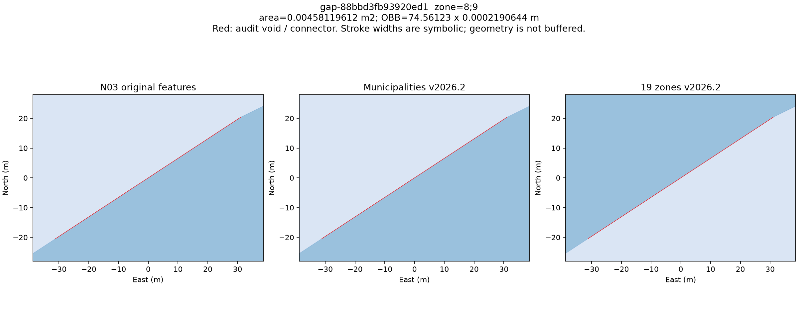
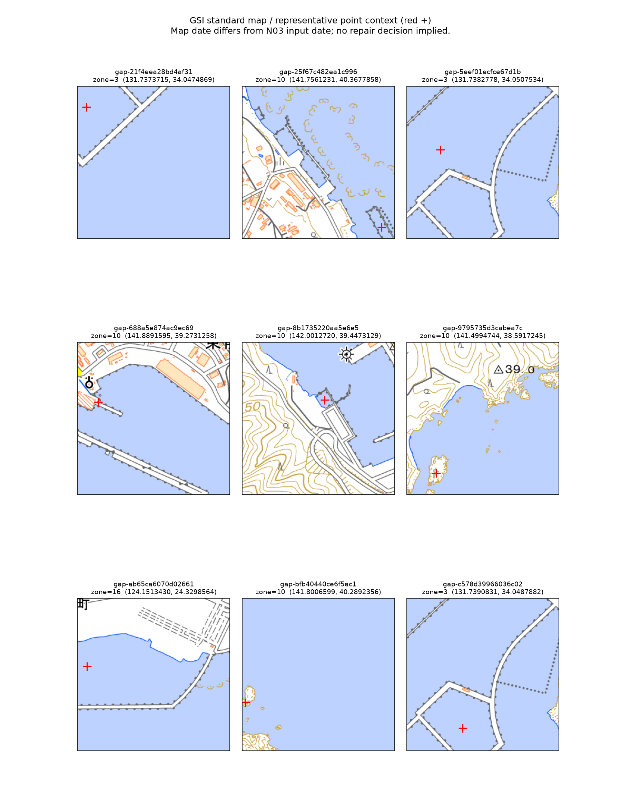

# 19系区域の内部空白・長狭な穴の調査（2026-10-15）

対象は `yo-1/japan-plane-rectangular-cs-zones` の現行Release **v2026.2** です。2026-10-15（JST）にRelease APIのlatestを確認しました。原典と公開物は読み取り専用で使用し、補修、スナップ、丸め、バッファ、簡略化は実施していません。森林等の別の集約単位の結果から19系の正常性を推定していません。

## 追補：岩礁付近2件の現在の扱い

[追補調査](rock-followup/README.md) で、2件ともSHP・GMLの個別地物に明示された内環であることを確認しました。地理院ベクトルでは代表点が水域面に入り、候補面積の約96.90%・98.09%が水域と重なります。**原典を維持し、補修は行いません。** 潮位条件・成因、法的所属、境界細部は未確定です。写真や岩の描画だけから陸部の欠落とは判断しません。追補後のテストは86件すべて成功しました。初回ZIPは保持し、最新の候補別判断は `repair-review.csv` に反映しています。

[完了事項と残作業](completion-status.md) に、AI側で完了した範囲と実機・追加資料が必要な確認を整理しています。

2026-10-16に[森林側の既存実機検査と共有データを照合](cross-thread-check-20261016/README.md) しました。共有19系の全列一致と先行／拡張版の計画区020の図形BLOB一致を確認し、既存結果を再利用します。新規の一括ArcGIS検査は依頼しません。

森林側の[追加実機結果](forest-runtime-handoff-20261016/README.md) も受領しました。拡張21候補は検査済みで米代川025の自己交差1件が残ります。図形認識・描画、File GDB変換、ESRI形状検査、公式境界との一致を区別し、19系への全国精度処理は保留します。

## 入力の特定

| 入力 | 版 | SHA-256 |
|---|---|---|
| 19系ZIP | v2026.2 | `c32ac8417ee604436e0a20280a6f2d3a1e73a3247c5a8db10230209daf9e3fbd` |
| 19系GeoPackage | 同ZIP内 | `9392e5e3fecedbab7ba774dc89c81bc353c265d16d66a1c86f6e341b5946eafc` |
| 市町村ZIP | v2026.2 | `cfdefd12ea7114796b26d4d9d10d244bd4b03c110b9dd7f2fcc9a12d92c9051b` |
| 市町村GeoPackage | 同ZIP内 | `1e09e083497bca003121473458321afb353aadaa660885c76b45f761ae72b492` |
| 公式N03全国GML ZIP | N03-20260101 | `1f714fca019e22e6f84012dba420384fc7b49c6ad8bd0a867ab1cfb593a78477` |
| N03 SHP | 同ZIP内 | `6325d7f08c9374198e27b2cffd01bd420411be8b3cf3528da0587c6cea35538d` |

ZIPと展開ファイルのサイズ・ハッシュは [input-manifest.json](input-manifest.json)、取得URLは [download-manifest.json](download-manifest.json) にあります。公開ZIPはRelease APIのasset digestと実測値を照合しました。N03のハッシュは今回の取得物の実測値で、提供元の署名ではありません。以前提供された `shp.zip` と今回の公式全国GML ZIPは別アーカイブです。同名・同年度だけで同一性を推定せず、市町村単位の比較も実行しました。

## 結果

初回監査の全検査は終了コード0で完了しました。当時のテストは **83件成功、スキップ0、失敗0** です。成果物の読み戻しでも無効・空形状は0件、SQLite整合性はokでした。詳細は [artifact-validation.json](artifact-validation.json) を参照してください。

| 確認項目 | 実測結果 |
|---|---:|
| N03原典 / 市町村版 / 19系版の地物数 | 125,130 / 1,911 / 19 |
| 原典と市町村版の市町村コード別・座標完全一致 | 1,905 / 1,905 |
| 同比較で双方向差分が空 | 1,904 / 1,905 |
| 原典と市町村版の19系別集約・座標完全一致 | 19 / 19 |
| 市町村集約から19系版への欠落面積 | **0㎡** |
| 19系版で増えた面積（微小穴削除） | 約0.00940884251㎡ |
| 削除された内部穴 / 新設された内部穴 | 293 / 0 |
| 市町村集約と19系版の外環・座標完全一致 | 19 / 19 |
| 現行19系の内部空白（同一系内） | **9件**（III系3・X系5・XVI系1） |
| 全国合併で検出した追加の系間空白 | **4件**（VIII・IX系間） |
| 閉じた空白の原因分類 | 13件とも原典由来 |
| 同一系内部で面積1㎡以上かつ外接矩形の長短比10以上 | **0件** |
| 今回補修した箇所 / 補修可能と確定した箇所 | 0 / 0 |

市町村単位の非空差分は既存記録と同じ高松市37201だけで、原典集約のみ約0.0335299814㎡、公開版のみ0㎡でした。正規化座標は一致し、差分代表点は原典の個別地物・公開市町村版とも未被覆です。この演算残差を公開版の欠落と断定しません。[市町村比較](municipality-comparison.csv) と [点の証拠](municipality-difference-point-evidence.json) に記録しました。

19系版の追加面は削除された293個の微小穴に対応し、削除穴はすべて公開処理の球面面積基準1㎡未満でした。外環は座標が完全一致しています。[系別比較](zone-comparison.csv) と [外環・穴削除の照合](exterior-preservation.csv) を参照してください。

同一系内の9件は約11.1〜199,963㎡で、最大の外接矩形長短比は約4.03です。港湾水面等として描かれる代表点がある一方、[gap-9795735d3cabea7c（約166㎡）](figures/gap-9795735d3cabea7c.png) と [gap-bfb40440ce6f5ac1（約64.6㎡）](figures/gap-bfb40440ce6f5ac1.png) は地理院地図の陸部・岩礁表現付近でした。地図の取得時点・精度はN03と同一ではないため、原典の地物欠落や所属を確定せず、追加確認として残します。湖面であるという一律の除外もしていません。

VIII・IX系間の4件は約0.000831〜0.004581㎡です。外接矩形長は約13.0〜74.6m、非常に細い形状ですが、同一系内部の補修対象に混ぜず、原典由来の系間離隔として維持します。小さい面積だから省略した候補ではありません。

外周近接検査は10,501,089頂点・122,983外環を対象に実行しました。15,897組（同一系外周15,023・系間874）の中点は、全組が原典・市町村版とも未被覆でした。距離0〜1µmが844組、1µm〜1mmが6組、1mm〜0.1mが58組、0.1〜1mが14,989組です。これらは**独立した穴の件数ではなく頂点対のサンプル**で、面の原因・所属は未確定です。[圧縮CSV一覧](exterior-screen.csv.gz) と [検査条件](exterior-summary.json) を保存しました。

一覧は [candidates.csv](candidates.csv)、補修段階・保全・保留は [repair-review.csv](repair-review.csv) です。系間候補の `zone` 欄は空欄で、隣接する系を `adjacent_zones` に記録します。表示上の現象と確定した候補はありません。対応する表示画像・条件が未提供なので、その不存在を主張するものでもありません。



図の赤線の太さは実際の幅を表しません。この候補の外接矩形は約74.56m×0.000219mです。原典・市町村版・19系版すべてに同じ未被覆領域があり、境界を動かす補修は行いません。



出典：地理院タイル（標準地図）を加工。赤い十字は候補の代表点です。原タイル・URL・実測SHA-256・取得日は [map-manifest.json](map-context/map-manifest.json) にあります。水面・陸部の描画は補助資料であり、候補全体の意味や行政区域の法的所属を確定するものではありません。


## 検査方法と分類

既存の [2026-10-13の形状監査](../geometry-audit-20261013/README.md) と `geometry_audit.common` の面積・内部リング・ハッシュ処理を再利用し、`audit_n03_geometry.py` で全1,905市町村の比較をやり直します。新しい `audit_zone_gaps.py` は、既存の系番号判定を使ってN03を19系ごとに集約し、原典→市町村集約→公開19系の双方向差分を計算します。正規化座標の一致と差分演算の空・非空を別々に記録します。微小な非空差分は演算残差もあり得るため、差分各成分の代表点について集約前のN03、市町村版、19系版の被覆数も記録します。

公開19系の全内部リングと、全19系を合わせた形状の内部リングを抽出します。後者では、個別系の外周に接する系間の閉じた空白も確認できます。候補の足切りに面積・長さ・幅の閾値を使いません。各リングの内側から、全19系が実際に覆う領域を差し引きます。したがって別の系の飛び地や同一系の島を、そのまま空白として数えません。内側にある公開領域と原典・市町村の面被覆、隣接する系・市町村コードを一覧に残します。候補IDは正規化したリングWKBのSHA-256先頭16桁です。

- **原典由来**：候補空白の原典・市町村版による面被覆がなく、代表点も双方で未被覆です。地物の意味や補修の正当性まで確定する分類ではありません。
- **加工で発生**：原典・市町村版の被覆が19系版で失われ、双方の代表点被覆でも裏付けられた候補です。
- **表示上の現象**：対象位置の実データと表示条件・画像を突き合わせて初めて確定できます。今回、特定の表示画像・位置は提供されていないため、この分類を推測で付けません。
- **未確定**：段階間の被覆や代表点が整合しないもの、他系の被覆があるもの、外周の近接だけが確認されたものです。演算残差と実際の欠落を区別するため、判断を保留します。

系が複数隣接する候補は「系間・外周として維持」、単一系だけが隣接する閉じた候補は「同一系内部」とします。この区分は幾何に基づくもので、法的な所属判断ではありません。湖面を候補から一律除外せず、他系の領域・外周・系間の離隔は補修対象にしません。

## 長さ・幅の読み方

`area_m2` はGRS80楕円体の測地面積です。位置は空白成分の内部代表点の経緯度（EPSG:6668）です。長さ・幅は候補ごとの局所正距方位図法で測ります。

- `obb_length_m` / `obb_width_m`：最小回転外接矩形の長辺・短辺です。
- `length_proxy_m`：周長Pの半分です。
- `width_proxy_m`：2A/P（Aは局所投影での面積）です。長い矩形に対して幅の目安になります。
- `obb_aspect`：外接矩形の長辺÷短辺です。報告中の「長狭」は比較の目安として比10以上を集計しますが、候補抽出の閾値には使いません。

曲がった細い隙間では外接矩形の幅が大きくなり得ます。2A/Pも最小の首幅ではなく、P/2も中心線の長さではありません。面積の大きな候補も含めて全一覧を確認してください。極小の差分は浮動小数点演算の限界に注意し、面積だけで真の欠落と判定しません。

## 外周につながる離隔の追加検査

`screen_zone_exterior_gaps.py` は全公開外環の頂点をGRS80の地心直交座標に置き、距離1m以内の**全頂点対**を検索します。同じ環で境界に沿って20m未満しか離れていない組と、距離0の共有点を除き、接続線の中点が全19系で未被覆のものを記録します。元の形状を変更する膨張・収縮・穴埋めは行いません。

これは頂点間の近接検査です。頂点と辺・辺同士だけが近い場合、幅1m超の開いた隙間、対象距離内の接続線の全長が空白かどうかを網羅する検査ではありません。海峡や港湾、水路、外周につながる細い入り江も含まれ得ます。閉じた面ではないので面積を捏造せず、`area_m2` は未定義と記録します。未確定・外周または系間の保全対象として、閉じた内部穴の一覧とは分けてあります。**今回の結果は、あらゆる開いた離隔の不存在を証明しません。**

## 確認用データ

大きなGeoPackageと入力はGitに追加せず、次に保存します。

- `output/zone-gap-audit-20261015/candidates.gpkg`：`void_candidates`（実際の空白）、`enclosing_rings`（囲みの全体）、`stage_differences`（段階間の双方向差分）、`zone_reference`（公開19系の参照形状）
- `output/zone-exterior-screen-20261015/exterior-screen.gpkg`：外周近接の接続線。閉じた空白の面ではありません。
- `output/n03-municipality-recheck-20261015/`：既存監査の再実行結果
- `figures/`：原典・市町村版・19系版を同じ局所座標で比較した代表箇所の拡大図

QGISでは `void_candidates` を赤色、`zone_reference` を半透明で重ね、候補IDで絞り込みます。`enclosing_rings` には飛び地を含む囲みもあるので、それ自体を穴埋め範囲にしないでください。`stage_differences` は極小の演算残差も残しており、修正対象を意味しません。接続線の線幅・図の赤線の太さも実際の幅を表しません。QGISのGUI上での表示操作は実施していません。GeoPackageの整合性・座標系・読み戻しを機械的に検証しています。

2026-10-15の利用者提供ArcGIS Pro画面では、`main.plane_rectangular_zones_2026` の全国表示と19件の属性表（`ZONE`・`ZONE_ROMAN`・`EPSG`列）を確認しました。利用者環境での19系レイヤの基本表示の確認です。対象実ファイルの版・SHA-256、ArcGIS Proのバージョン、形状検査等の範囲は未確認です。流域・森林計画区側の検証完了は利用者報告として受け取りました。各データの確認範囲は [VALIDATION.txt](../../VALIDATION.txt) に記録しています。

続いて、ArcGIS Pro 3.7.1向けの森林側図形型宣言比較資料3件を受領し、添付ハッシュと比較記録の整合性を確認しました。この環境の公開19系版・市町村版はSQL宣言も既に `MULTIPOLYGON` です。調査用成果物の宣言とArcGIS未確認範囲を含め、[資料受領記録](arcgis-evidence/README.md) に整理しています。

調査用データについては、実体型を明示した[ArcGIS比較用コピー5ファイル・9レイヤ](arcgis-comparison/README.md) を作成しました。16,248件の図形バイナリ・属性・FIDの同一性、GDAL読み戻しを確認しています。ArcGIS実機確認は未実施です。追加スクリプトを含むテストは90件成功、スキップ・失敗0件です。

## 補修案の扱い

今回補修した箇所は0件です。候補の存在と、湖面・水路・境界を含む地物の意味は別です。

1. 原典由来と確認でき、実際の不適切な隙間であり市町村所属が明確なら、派生市町村データの段階で補修を検討します。
2. 市町村所属は不明でも所属する系が明確なら、その系の派生区域段階で補修を検討します。単に周囲に同じ系しかないという証拠だけで補修を確定しません。
3. 他系の飛び地、系間境界、外周に接する離隔は維持します。所属不明や表示位置・地物の意味が未確認のものは保留します。

候補別の整理は `repair-review.csv` に記録します。「補修案」は条件付きの検討段階であり、自動補修の許可ではありません。確定のために必要な情報は候補位置の地物の意味・所属と、表示現象なら対応する位置・表示条件です。

## 再実行

基準となる既存コードは `61b47804ed0662d7169f1cc4d6be7a4eb003439d` です。追加スクリプトとデータのハッシュは [workflow-manifest.json](workflow-manifest.json) に記録します。Python 3.12を使い、リポジトリのルートで実行します。依存宣言・ロックファイルは変更していません。今回の追加可視化・外周検査にはMatplotlibとSciPyを使います。

```bash
python3.12 -m venv .venv
.venv/bin/python -m pip install -r scripts/geometry_audit/requirements.txt
.venv/bin/python -m pip install matplotlib==3.11.2 scipy==1.18.1
.venv/bin/python scripts/fetch_zone_gap_inputs.py --output output/gap-inputs
.venv/bin/python scripts/audit_n03_geometry.py \
  --source-shp output/gap-inputs/N03-20260101.shp \
  --municipalities output/gap-inputs/plane_rectangular_municipalities_2026.gpkg \
  --output output/n03-municipality-recheck-new
.venv/bin/python scripts/audit_zone_gaps.py \
  --source-shp output/gap-inputs/N03-20260101.shp \
  --municipalities output/gap-inputs/plane_rectangular_municipalities_2026.gpkg \
  --zones output/gap-inputs/plane_rectangular_zones_2026.gpkg \
  --output output/zone-gap-audit-new --workers 3
.venv/bin/python scripts/screen_zone_exterior_gaps.py \
  --zones output/gap-inputs/plane_rectangular_zones_2026.gpkg \
  --source-shp output/gap-inputs/N03-20260101.shp \
  --municipalities output/gap-inputs/plane_rectangular_municipalities_2026.gpkg \
  --output output/zone-exterior-screen-new
.venv/bin/python scripts/plot_zone_gaps.py \
  --audit output/zone-gap-audit-new \
  --exterior-screen output/zone-exterior-screen-new \
  --include-candidates gap-9795735d3cabea7c,gap-bfb40440ce6f5ac1 \
  --source-shp output/gap-inputs/N03-20260101.shp \
  --municipalities output/gap-inputs/plane_rectangular_municipalities_2026.gpkg \
  --zones output/gap-inputs/plane_rectangular_zones_2026.gpkg \
  --output output/zone-gap-figures-new
.venv/bin/python scripts/validate_zone_gap_outputs.py \
  --audit output/zone-gap-audit-new \
  --exterior-screen output/zone-exterior-screen-new \
  --municipality-review output/n03-municipality-recheck-new
.venv/bin/python scripts/plot_zone_gap_map_context.py \
  --audit output/zone-gap-audit-new --output output/zone-gap-map-new
N03_DBF="$PWD/output/gap-inputs/N03-20260101.dbf" \
  .venv/bin/python -m unittest discover -s tests -v
```

解析・描画の出力ディレクトリは未作成のものを指定してください。取得スクリプトは既存入力を上書きせず、ハッシュとZIP内部の内容を再照合します。3並列の系別比較と全市町村再検証は4 CPU・約33 GiBメモリの環境で実施しました。低メモリ環境では `--workers 1` にしてください。処理系の版と実測時間は `summary.json` にあります。

データは国土交通省「国土数値情報（行政区域データ）2026年版」を加工したものです。出典・利用条件は [DATA_LICENSE.md](../../DATA_LICENSE.md) を参照してください。
