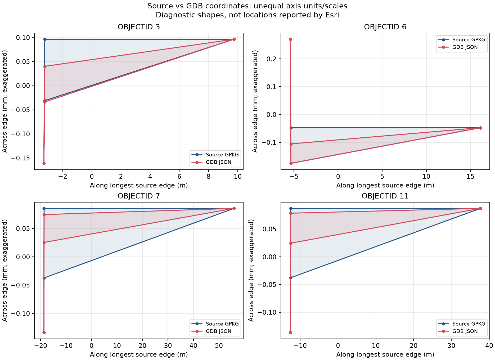

# ArcGIS Pro実機検査と変換後座標比較（2026-10-17）

調査用 `candidates-typed.gpkg` の `void_candidates` 13件は、元のGeoPackageを直接検査すると13件合格でした。File Geodatabaseへ出力した後は、Esri方式で4件に自己交差が報告されました。正式19系区域レイヤの自己交差を示す結果ではありません。

利用者のArcGIS Pro 3.7.1の画面・実行メッセージと、提供JSONを根拠にしています。AI環境でArcGISを実行した結果ではありません。原典・正式Release・調査用GPKGは変更していません。

## 実機で確認されたこと

|対象・操作|結果|証拠の範囲|
|---|---|---|
|GPKGの図形認識・属性表示|ポリゴン13件、候補ID・属性を表示|利用者画面|
|代表候補の拡大描画|fid 4・9・12を描画|意味・所属や境界の正しさの判定とは別です|
|GPKG直接のCheck Geometry|13件合格、検査不能0、エラー0|Esri方式を指定する手順で実行。受領した完了メッセージ自体に方式欄はありません|
|GDBへのエクスポート|13件、OBJECTIDとcandidate_idが対応|出力属性テーブル画面|
|GDBのEsri方式Check Geometry|自己交差4件、FEATURE_ID 3・6・7・11|方式欄・結果テーブル・WARNING 000442の画面|
|出力空間参照|JGD2011 EPSG:6668|GDBプロパティ画面|
|出力XY座標精度・許容値|1e-9度、8.98315284119521e-9度|GDBプロパティ画面。JSONだけからは読み取れません|

機械可読の転記は [observed-results.json](observed-results.json) に保存しました。画面に写るローカルパスや利用者情報は転記していません。

## 入力と同一性

- 元GPKG SHA-256：`874f085882f79d55bb41d986210bc58654db9d41827ea09b62e8def9738c9cd3`。既存の[比較コピーのハッシュ表](../arcgis-comparison/SHA256SUMS.txt)と一致します。
- 利用者提供JSON：103,449 bytes、SHA-256 `37acbb8f0b6602f35f01f9fd0de664b029e41eac1ac959caf17611296ae87dea`。
- JSONは13地物・13外周・2,133保存座標（閉点込み）です。全候補ID・OBJECTIDの一意性、候補集合、元からある属性値と座標数が一致しました。各形状は単一外周のXY Polygonです。
- 利用者PC上で実際に入力したGPKGのファイル全体SHA-256は未受領です。比較元は上記の公開比較コピーです。画面のファイル名だけで、利用者PC上の入力ファイル全体の同一性まで確定しません。
- 座標そのものはGPKGと完全一致しません。最大成分差は約5.0003e-10度です。全測定値は [comparison.json](comparison.json) にあります。入力2ファイルの処理前後ハッシュも一致しました。

## 森林側の最新記録との照合

[森林PR #6](https://github.com/yo-1/japan-forest-planning-zones/pull/6) のコミット `e74589a0294dac28d2de41b6fe006379edce9b6b` を確認しました。照会時点では未マージです。関連チャット本文・非公開文書を読んだとは扱いません。

森林側の[JSON/GDB全件比較](https://github.com/yo-1/japan-forest-planning-zones/blob/e74589a0294dac28d2de41b6fe006379edce9b6b/docs/void-candidates-20261017/JSON_MATCH.md)では、同じSHA-256のJSONがGDB本体の全座標・全順序・31属性と一致しています。公開された[比較結果の写し](forest-pr6-json-match.json)について、入力ハッシュ・全13候補ID・座標数を今回の入力と照合しました。この環境でGDB本体の検査を再実行したという意味ではありません。

今回の元GPKG→JSON比較と、森林側のGDB→同一JSON比較を組み合わせることで、既存の「元GPKGとの変換前後が未照合」という不足を、この13件について補えます。全国森林GDBや正式19系区域へ一般化しません。森林側の同じ検査を利用者へ再依頼しません。

森林025では、未変更版の保存済みEsri結果1行と2頂点削除候補の0行、GDB間で局所2頂点削除以外の全座標一致が新たに記録されています。「比較結果未受領」という古い状態から更新します。ただし原典との境界差・流域との階層整合性が未解決で、全国採用は保留です。森林PR #6のマージや全国GDBの追加解析は森林側の作業と分けます。

## 座標・幅・許容値の追加解析

Shapely 2.1.2 / GEOS 3.13.1、NumPy、pyproj 3.8.0を使用しました。JSONの全13形状はGEOSで有効です。これはEsri方式の合格を意味しません。

|OBJECTID|候補ID|非隣接頂点の距離（度）|最小クリアランス/XY許容値|GDB形状の矩形幅概算（mm）|
|---|---|---:|---:|---:|
|3|gap-2cfa5a8f6e759bce|9.999894e-10|0.0845|0.200|
|6|gap-8113f3b0bf65eea8|9.999894e-10|0.0792|0.445|
|7|gap-88bbd3fb93920ed1|9.999894e-10|0.0522|0.208|
|11|gap-b7f28ed2a89fa1dd|9.999894e-10|0.0581|0.215|

閉点と巡回隣接を除く頂点対を全13件で検索しました。許容値以内の非隣接頂点組は上の4件だけで、各1組、0始まりpos 1・3でした。Esriの報告対象4件と一致し、森林側の本体検査とも一致します。

最小クリアランスも4件だけが許容値未満で、他9件は超過しました。この値はGEOSが求める形状の頑健性の尺度で、地上の隙間幅そのものではありません。同じ度単位の座標空間で許容値と比較しています。幅は代表点を中心にしたGRS80の局所LAEA投影の最小回転矩形短辺です。継承された `obb_width_m` と別測定です。

4件ともGDB出力後の面積は小さくなりました。局所LAEA面積とGRS80測地線面積を別々に記録しています。サブmm形状の面積・幅は倍精度計算の概算であり、精密測量値として扱いません。

元形状を1e-10・1e-9・1e-8度へ丸める診断をメモリ内だけで行いました。1e-9度への単純な丸めでは全13件がGEOS有効のままで、Esri自己交差を再現しません。粗い1e-8度では6・7・11がGEOS無効になりました。粗くすれば解決するという結論ではありません。1e-9度格子の出力と実JSONも、丸めの半格子や浮動小数点差を含め完全一致とは限りません。



図は長辺方向をm、横断方向をmmで描き、幅を強調しています。実地の縦横比ではありません。Esriが直接報告した問題座標の図でもありません。

## Esri公開仕様と原因の位置づけ

2026-10-17に次の公開文書を読みました。`latest`文書であり、利用者の3.7.1の内部実装を確認する資料ではありません。

- [Check Geometry](https://pro.arcgis.com/en/pro-app/latest/tool-reference/data-management/check-geometry.htm)：GeoPackageも検査対象で、Esri方式はEsri Simplifyによる位相的正しさを確認すると説明されています。
- [XY Tolerance](https://pro.arcgis.com/en/pro-app/latest/tool-reference/environment-settings/xy-tolerance.htm)：座標を等しいと見なす距離を説明し、既定値の変更を推奨していません。
- [XY Resolution](https://pro.arcgis.com/en/pro-app/latest/tool-reference/environment-settings/xy-resolution.htm)：出力の座標格子を説明しています。

実機結果・頂点近接・クリアランスは、座標格子とXY許容値に関係する判定という仮説と整合します。しかしEsri内部のSimplifyやクラスタリングを再現しておらず、4件の直接の問題座標も結果表にありません。原因機序は未確定です。許容値以下の点を独自にまとめて同じ結果が出ても、Esri内部原因の証明にはなりません。

## 他レイヤの確認範囲と重複除外

|レイヤ|件数|既存証拠と今回の範囲|
|---|---:|---|
|void_candidates|13|今回GPKG・GDBの実機結果と座標比較を追加しました|
|zone_reference|19|正式版と同じ全19行の基本描画を既存記録から再利用します。GDB後のEsri全件合格を意味しません|
|enclosing_rings|13|既存GDAL読み戻し済み。独立の実機結果は未照合です|
|stage_differences|293|同上。微小穴削除の差分であり、本13件と別対象です|
|differences|1|同上。高松市の数値演算残差であり、地理的な欠落と断定しません|
|connectors|15,897|同上。線の頂点対サンプルで、独立した穴15,897件ではありません|
|evidence|6|同上。原典リング追跡用です|
|context_polygon / context_multipolygon|4 / 2|同上。地図文脈用です|

GDALでの全9レイヤ16,248件の検査結果を再利用します。この表は未実施の一括実機検査を依頼するものではありません。他チャットに記録がある可能性を考慮し、未照合と未実施を区別します。

## 判定と残る外部確認

- 4件はVIII/IX系間の原典由来の離隔を可視化した調査用形状です。原典由来という判定と、変換後のEsri判定を区別します。系間離隔を維持し、形状の削除や穴埋めは行いません。
- 岩礁付近9・12は今回のGDB検査で問題報告がありませんでしたが、意味・法的所属の確定とは別です。[原典SHP/GML・地理院資料の既存追跡](../rock-followup/README.md)以上の所属根拠は得ていません。追加の公的根拠がない状態で補修可能としません。
- 過去に指摘された隙間画像の具体的位置は未特定です。今回の13候補の拡大画面だけで、過去画像との一致を推定しません。
- 原典・既存Release・全国版への精度処理採用は保留です。補修を検討する場合は、市町村所属が明確なら派生市町村段階、系のみ明確なら派生区域段階、所属不明なら保留という既存方針を維持します。

追加のArcGIS再実行・同じ資料の再提出は、現段階では利用者へ依頼しません。

## 再実行

リポジトリルートで、既存の `scripts/geometry_audit/requirements.txt` の環境を使用します。出力先は未作成のファイル名を指定します。

```sh
MPLCONFIGDIR=/tmp/zone-audit-mpl .venv/bin/python scripts/compare_arcgis_candidate_json.py \
  docs/zone-gap-audit-20261015/arcgis-runtime-20261017/void_candidates_gdb.json \
  output/arcgis-comparison-20261015/candidates-typed.gpkg \
  output/arcgis-runtime-20261017/new-comparison.json \
  --figure output/arcgis-runtime-20261017/new-comparison.png
```

GeoPackageは読み取り専用で開き、入力ハッシュ不変を確認します。候補の欠落・重複、異なるCRS、複数リングなど対象外の入力では停止します。既存出力を上書きしません。将来の別レイヤへ無条件で流用するスクリプトではありません。
