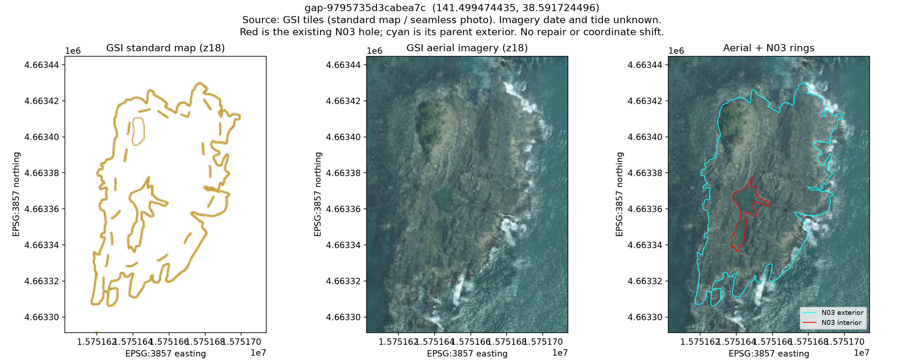
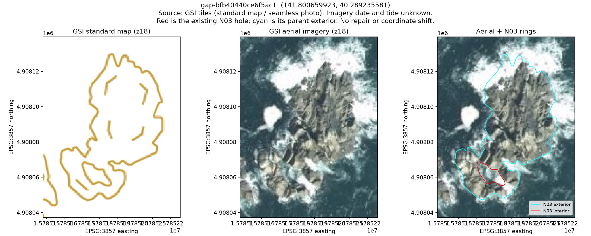

# 岩礁付近2件の追補調査（2026-10-15）

**2件とも原典の個別地物で明示された内環です。地理院ベクトルの水域面とも整合するため、原典を維持し、補修は行いません。** 穴の法的な所属、潮位条件や成因、境界細部の妥当性まで確定したものではありません。

前回はズーム16の標準地図で代表点が岩礁・陸部表現付近にあったため保留しました。今回、元のSHPのバイナリ内環、同じ公式ZIPに含まれる市町村版GML、ズーム18の標準地図・空中写真、地理院ベクトルの地物種別を調べました。初回成果物ZIPは変更していません。現在の一覧は親ディレクトリの `repair-review.csv`、従前の一覧は [initial-repair-review.csv](initial-repair-review.csv) です。

## 原典で確認できたこと

| 候補 | 石巻市付近 | 久慈市付近 |
|---|---|---|
| 候補ID | `gap-9795735d3cabea7c` | `gap-bfb40440ce6f5ac1` |
| 面積（初回のGRS80測地面積） | 約166.388㎡ | 約64.557㎡ |
| SHPレコード番号（1始まり） | 21,264 | 15,560 |
| 外側地物の属性コード | 04202（石巻市） | 03207（久慈市） |
| SHPの対象リング | 2本目、反時計回りの内環 | 2本目、反時計回りの内環 |
| GML曲線 | `cv21263_1` | `cv15559_1` |
| GML曲面 | `sf21263` | `sf15559` |
| GMLの指定 | `gml:interior` | `gml:interior` |
| SHPとGMLの輪郭間距離（Hausdorff） | 約0.665mm | 約0.562mm |

SHPで外環と穴が別リングとして記録され、GMLにも対応する内環の参照があります。GMLの周囲地物の属性も、それぞれ石巻市・久慈市です。SHPとGMLは丸め桁が異なり座標の完全一致ではありませんが、局所投影での輪郭間距離は1mm未満です。全DBFレコード125,130件は削除フラグなしでした。削除された地物を読み飛ばしたことによる空白ではありません。

この属性は**外側地物の属性**であり、除外された内環の法的所属を証明しません。GMLとSHPは同一提供物の表現違いで、独立した現地測量ではありません。リング向きだけに依存せず、GMLの内環指定も照合しています。

一次証拠は [source-ring-evidence.json](source-ring-evidence.json) と [source-ring-evidence.gpkg](source-ring-evidence.gpkg) に保存しました。GMLは公式全国ZIP内の `N03-20260101.xml`（580,655,758 bytes）です。XML実測SHA-256は `f72fb3bc7b38a1165c825049e00fbf8d8e2fefa57f7f3a6c34074b6d2b5525bb`。元のSHP・DBF・ZIP等のハッシュも実行前後で照合しました。

## 地図記号と水域面の照合

国土地理院ベクトルタイル提供実験のズーム16を使用しました。[公式データ仕様](vector-context/dataspec.pdf) は、`waterarea` の `ftCode=5000` を「水域」、`coastline` の `ftCode=5102` を「海岸線−岩等に接する部分」としています。茶色の岩・崖等の表示と、水域としてのデータの区分を分けて確認しました。

| 検査 | 石巻市付近 | 久慈市付近 |
|---|---:|---:|
| 候補の内部代表点が水域面に入るか | 入る | 入る |
| 候補面積に対する水域面の重なり | 96.90% | 98.09% |
| 候補のうち水域面外に残る面積（局所投影） | 約5.150㎡ | 約1.232㎡ |
| 候補内環から岩等に接する海岸線までの距離・標本中央値 | 約0.075m | 約0.044m |
| 同距離・標本最大値 | 約0.264m | 約0.265m |

面積割合は候補ごとの局所正距方位図法による面積比です。水域である確率でも、法的所属の確度でもありません。内環境界を最大0.25m間隔で標本化し、`ftCode=5102` の線への最近距離を測りました。復号した線分モデル内で、未標本部分を含む距離の上限は標本最大値+0.125m（両件とも約0.390m）です。これは現地の位置精度の保証ではありません。

水域面と完全一致ではありません。ベクトルの量子化・表現、更新時点、位置精度等を含め、残る面積差の原因を一つに断定しません。提供実験READMEの更新情報は2026年7月1日時点で、N03の2026年1月1日版とは異なります。両データは国土地理院の共通原典を含むため、独立した測量による二重確認とも扱いません。

詳細な属性・面積・距離・取得URL・実測SHA-256は [vector-context.json](vector-context/vector-context.json)、図形は [vector-context.gpkg](vector-context/vector-context.gpkg) にあります。`outside_GSI_water` は境界表現の差分であり、補修すべき部分とは判定していません。

## 空中写真と標準地図





出典：地理院タイル（標準地図・全国最新写真）を加工。水色はN03の外環、赤はN03の内環です。座標合わせのためのスナップ・平行移動・補修は行っていません。軸はEPSG:3857の投影座標で、地上距離の測定には使いません。

写真には岩盤、暗部、波・白波があり、写真だけから穴全体を陸部／水部と確定できません。撮影日・潮位・位置精度も確定していません。取得日と原タイルは [tile-manifest.json](figures/tile-manifest.json) と `figures/tiles/` に記録しました。

## 現在の判断と残る確認

- **確定**：原典の個別地物の内環が、市町村版・19系版に継承されています。今回の集約で生じた欠落ではありません。
- **データ上の裏付け**：2件とも代表点と候補の大部分が公的ベクトルの水域面に入り、内環は岩等に接する海岸線と近接します。
- **扱い**：原典を維持し、補修は保留します。岩礁に見えるという理由による穴埋めは行いません。
- **未確定**：潮だまり・海との接続・干出等の成因や潮位条件、内環の法的な行政区域所属、面積差の境界細部です。これらは写真や周囲の市町村コードだけからは確定できません。

通常の開発・配布データの維持に、追加補修作業はありません。原典と異なる穴埋めを検討する場合は、対象内環の意味・所属・適切な境界について、公的資料等の追加根拠を得てから別途判断します。照会の送信や公開物の更新は実施していません。

## 再実行と検証

初回調査の依存関係に加え、ベクトルの復号には `mapbox-vector-tile==2.2.0` を使用しました。依存宣言・ロックファイルは変更していません。出力は未作成のディレクトリを指定してください。

```bash
.venv/bin/python -m pip install mapbox-vector-tile==2.2.0
.venv/bin/python scripts/inspect_rock_holes.py \
  --source-shp output/gap-inputs/N03-20260101.shp \
  --source-zip output/gap-inputs/N03-20260101_GML.zip \
  --audit output/zone-gap-audit-20261015 --output output/rock-followup-new
.venv/bin/python scripts/plot_rock_hole_detail.py \
  --evidence output/rock-followup-new --output output/rock-figures-new
.venv/bin/python scripts/inspect_rock_vector_context.py \
  --evidence output/rock-followup-new --output output/rock-vector-new
N03_DBF="$PWD/output/gap-inputs/N03-20260101.dbf" \
  .venv/bin/python -m unittest discover -s tests -v
```

テストは **86件成功、スキップ0・失敗0**。追加の3件は、SHPの生リング順序・向き、GMLの緯度経度順と内環指定・属性参照、似た範囲でも位置がずれた別曲線を誤採用しないことを検証します。GeoPackageの読み戻し・整合性と入力保存の検査結果は `validation.json` にあります。新しいスクリプト等の実測ハッシュは `workflow-manifest.json` に保存します。

N03由来データの出典・利用条件は [DATA_LICENSE.md](../../../DATA_LICENSE.md)、ベクトルは「国土地理院ベクトルタイル提供実験」です。
